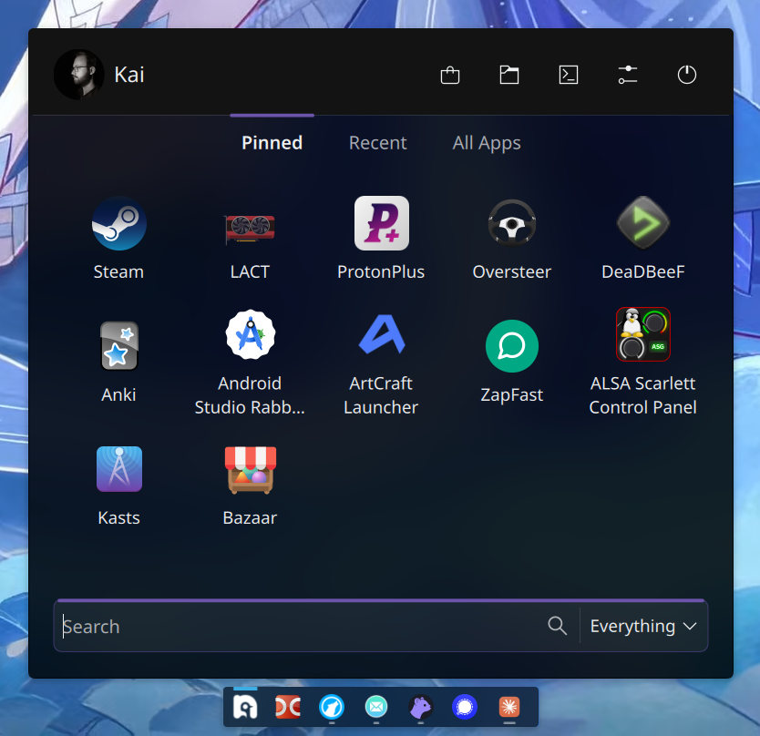

# Laetum Launcher

A modern application launcher (start menu) for KDE Plasma 6, built on the same backend models as Kickoff, so it shares your favourites, search runners and app list.

The design is modelled after the [Start Menu Concept](https://dribbble.com/shots/16617776-Start-Menu-Concept-1-2) shot on Dribbble.



## Features

- **Pinned, Recent and All Apps** tabs with a sliding accent indicator
- **All Apps** grouped under A–Z headers
- **Optional category tabs** (e.g. Games, Development, "Brave Browser Apps"), picked in settings
- **Search** across all KRunner plugins, with a filter for Everything / Apps / Files / Settings
- **Header** with your avatar and name, plus buttons for the software store, Files, Terminal, System Settings, Info Center (optional) and Power (lock, sleep, hibernate, restart, shut down, switch user, log out); every button except Power can be toggled, and the buttons come in three sizes
- Optional **hover and click animations** for apps (icons lift on hover and squeeze when pressed)
- Uses your **colour scheme's accent colour**, even with Plasma styles that ship their own highlight colour
- Opaque header over a translucent body that follows your Plasma style's blur
- **Keyboard friendly:** type to search, arrow keys to move, Enter to launch, Tab to switch tabs, Menu key for the context menu, Esc to clear or close
- Opens with the **Meta key**, like Kickoff
- Right-click any app to pin or unpin it and for its other actions
- **Drag pinned apps to reorder them** (or select one with the arrow keys and press Ctrl+Left/Right)

## Requirements

- KDE Plasma 6 (tested on 6.7)
- Kirigami Addons (`kirigami-addons`)

## Install

Download `laetum-launcher-<version>.plasmoid` from the [Releases](../../releases) page, then:

```bash
kpackagetool6 -t Plasma/Applet -i laetum-launcher-1.2.plasmoid
```

Or from a checkout of this repository:

```bash
kpackagetool6 -t Plasma/Applet -i .
```

To update an existing install, use `-u` instead of `-i`.

Then right-click your current menu icon on the panel → **Show Alternatives…** → **Laetum Launcher**, or add it with **Add Widgets…**.

## Settings

Right-click the icon → **Configure Laetum Launcher…**

| Setting | What it does |
| --- | --- |
| Panel icon | The icon shown on the panel |
| Grid columns | Number of app tiles per row (3–8) |
| Header → Button size | Small, Medium or Large header buttons; the spacing grows with them |
| Header → Buttons | Show or hide the Software store, Files, Terminal, System Settings and Info Center buttons (Info Center is off by default; Power is always shown) |
| Software store app | Desktop file ID or command for the store button (default `org.dnf.AppCenter`, the DNF App Center) |
| Terminal app | Desktop file ID or command for the terminal button (default `org.kde.konsole`) |
| Items → Animations | Animate apps on hover and/or on click (both on by default) |
| Show the Recent tab | Show or hide the Recent tab |
| Open on tab | Which tab the menu opens on |
| Category tabs | Extra tabs for any of your application categories |

## AI Disclosure

The majority of this project's source code was written with the help of AI tools. Because the code is largely AI-generated, it builds on the collective work of countless developers who share their knowledge openly — and it should give back in the same way. For this reason, this project is and must always remain open source.

## License

Laetum Launcher is free software: you can redistribute it and/or modify it under the terms of the GNU General Public License as published by the Free Software Foundation, either version 3 of the License, or (at your option) any later version (GPL-3.0-or-later). See [LICENSE](LICENSE).
